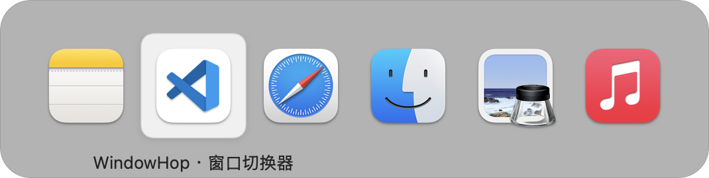
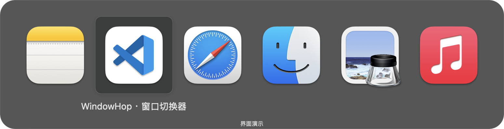

# 跃窗 WindowHop

**在窗口之间轻快跳转。** 一个使用 Swift、AppKit 和 SwiftUI 独立实现的 macOS 窗口切换器。

[下载安装包](https://github.com/marriannedagwwn-bot/WindowHop/releases/latest) · [MIT 开源协议](LICENSE) · [参与开发](CONTRIBUTING.md) · [提交问题](https://github.com/marriannedagwwn-bot/WindowHop/issues)

支持 **Apple Silicon · macOS 15 及以上**。当前版本 **0.3.2**，界面为中文。



## 你可以用它做什么

- **直接切换到窗口**：缩略图、应用图标、窗口标题三种显示方式，键盘或鼠标都能操作。
- **看得舒服**：中性毛玻璃选中背景、弹簧移动和列表呼出动画，支持浅色、深色及跟随系统。
- **快速找到目标**：按应用名或窗口标题搜索，按应用、屏幕和当前可见桌面筛选，选择最近使用或名称排序。
- **顺手整理窗口**：关闭、最小化、恢复、切换全屏、隐藏应用和正常退出应用。
- **按自己的习惯设置**：显示尺寸、快捷键、松键行为、排除应用、登录启动和 JSON 设置导入／导出。

<details>
<summary>查看其他外观</summary>

深色应用图标模式：



窗口缩略图模式：


窗口标题模式：


</details>

图片使用应用内的示例数据，用于展示布局；实际毛玻璃会随窗口背后的内容变化。更新记录见 [CHANGELOG](CHANGELOG.md)。

## 下载与安装

1. 在 [最新发布页](https://github.com/marriannedagwwn-bot/WindowHop/releases/latest) 下载 `WindowHop-0.3.2-arm64.dmg`；也提供 `WindowHop-0.3.2-arm64.zip`。
2. 打开 DMG，将 `WindowHop.app` 拖到「应用程序」。使用 ZIP 时，解压后将应用移入「应用程序」。
3. 打开「跃窗 WindowHop」，在设置中完成下面的权限授权。
4. 点击设置底部的「打开窗口列表」，或使用默认快捷键 **⌃⌥ Tab（Control + Option + Tab）**。

应用采用 **ad-hoc 签名，尚未经过 Apple 公证**。首次打开可能被 macOS 的安全检查拦截，请在「系统设置 → 隐私与安全性」查看针对该应用的提示。也可以按下文从源码构建。

### 系统权限

| 权限 | 用途 | 是否必需 |
| --- | --- | --- |
| 辅助功能 | 读取与操作窗口、监听全局快捷键 | 窗口切换所需 |
| 屏幕录制 | 窗口缩略图、所选窗口的捕获图像预览 | 可选；未授权时使用应用图标 |

设置中的「通用 → 系统权限」可以查看状态并打开系统授权页面。更改屏幕录制权限后，请退出并重新打开应用。重新编译或更换安装副本后，系统可能要求重新授权。

如果系统开关已打开，但跃窗仍显示「尚未允许」，请在对应权限列表移除旧的 WindowHop 条目，再添加「应用程序」中的当前副本，然后退出并重新打开。当前安装包采用本地签名，升级后可能需要这一步。

快捷键可改为 `⌥ Tab` 或 `⌘ Tab`；升级会沿用已有设置。若同时运行其他窗口切换工具，请避免使用相同快捷键。监听状态异常时，可在「控制」页点击「重新连接快捷键」。

## 快捷键

以下操作在窗口列表打开时生效：

| 操作 | 按键 |
| --- | --- |
| 下一个／上一个窗口 | Tab／Shift + Tab |
| 按位置选择 | 方向键 |
| 确认切换 | 松开呼出修饰键，或 Enter；也可点击目标 |
| 取消 | Esc，或点击面板外部 |
| 搜索 | S，然后输入应用名或窗口标题 |
| 关闭窗口 | W |
| 最小化／恢复 | M |
| 进入／退出全屏 | F |
| 隐藏／显示应用 | H |
| 正常退出应用 | Q |

按 **Option + 反引号键（Tab 上方的键）**，或使用菜单栏的「当前应用的窗口」，可只查看当前应用。

搜索支持空格分隔的多个词，所有词都需匹配。搜索中，字母用于输入；Tab、上下键与 Enter 用于选择。Esc 依次清空查询、退出搜索、关闭列表。关闭窗口或退出应用时，未保存内容仍由目标应用处理。

设置可将松开修饰键后的行为改为「保持列表」或「进入搜索」。默认显示延迟为 100 毫秒，也可设为立即显示。「预览所选窗口」默认关闭；开启后显示捕获图像的放大预览。

## 从源码构建

构建需要 **Apple Silicon Mac、Xcode 26，或包含 macOS 26 SDK 的对应 Command Line Tools**。代码使用 Swift 5 语言模式，运行目标仍为 macOS 15 及以上。当前构建脚本只输出 `arm64` 应用。

```sh
git clone https://github.com/marriannedagwwn-bot/WindowHop.git
cd WindowHop
./Scripts/build.sh
open WindowHop.app
```

脚本编译源码、生成图标并执行本地签名，无第三方包依赖。也可指定构建目录和应用输出位置：

```sh
WINDOWHOP_BUILD_DIR="$TMPDIR/windowhop-build" \
WINDOWHOP_APP_DIR="$PWD/dist/WindowHop.app" \
./Scripts/build.sh
```

运行内置自检：

```sh
./WindowHop.app/Contents/MacOS/WindowHop --self-test
```

当前包含 **362 项纯规则自检**，覆盖输入状态、布局导航、身份匹配和设置等规则；它们不会操作真实窗口，也不能替代跨应用与系统权限验收。详见 [验证说明](docs/testing.md) 和 [架构说明](docs/architecture.md)。

构建完成后，可以生成带「应用程序」快捷入口的 DMG、ZIP 和 SHA-256 校验文件：

```sh
./Scripts/package.sh
```

产物位于 `dist/`。可通过 `WINDOWHOP_APP_DIR` 选择应用、`WINDOWHOP_RELEASE_DIR` 选择安装包输出目录；脚本不会覆盖已有的同版本安装包。

## 隐私与能力边界

应用运行无需联网，没有遥测或自动更新服务。正常使用时，窗口捕获图像只缓存在进程内存中，不写入磁盘。缓存最多保留 40 张，超过 10 分钟的记录会在下次加载时清理；普通缩略图最大约 720 × 480，开启放大预览时最大约 1440 × 960。

- 缩略图与放大预览是**捕获图像**，不是持续实时视频。无法捕获的窗口回退为应用图标，不会为了截图恢复最小化窗口。
- 「当前可见桌面」依据系统报告的可见窗口集合筛选，不能代表完整的 Space 归属。跨 Space、复杂标签页、受保护窗口及部分应用的辅助功能支持仍有限制。
- 枚举有时间预算，响应较慢的应用可能被略过。多显示器、登录重启及 macOS 26 等场景仍需更广泛的实际验证。
- 尊重系统的「减少动态效果」「减少透明度」和「增强对比度」设置。性能会受窗口数量、截图尺寸和其他应用影响，当前没有覆盖各类设备的基准测试。

## 参与与致谢

欢迎通过 [Issues](https://github.com/marriannedagwwn-bot/WindowHop/issues) 提交可复现的问题，或阅读 [贡献指南](CONTRIBUTING.md) 后提交改进。

窗口切换交互参考了 [AltTab](https://github.com/lwouis/alt-tab-macos)。感谢原项目提供的设计启发；WindowHop 为独立实现，未复制其源码、图标或授权服务，也不承诺完全等价的功能。

本项目自有源码与资源按 [MIT License](LICENSE) 开源。示例图片中的第三方应用名称与图标归各自权利人所有。
